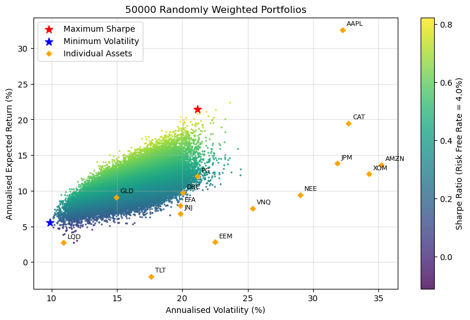
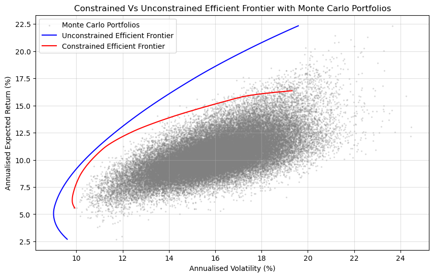
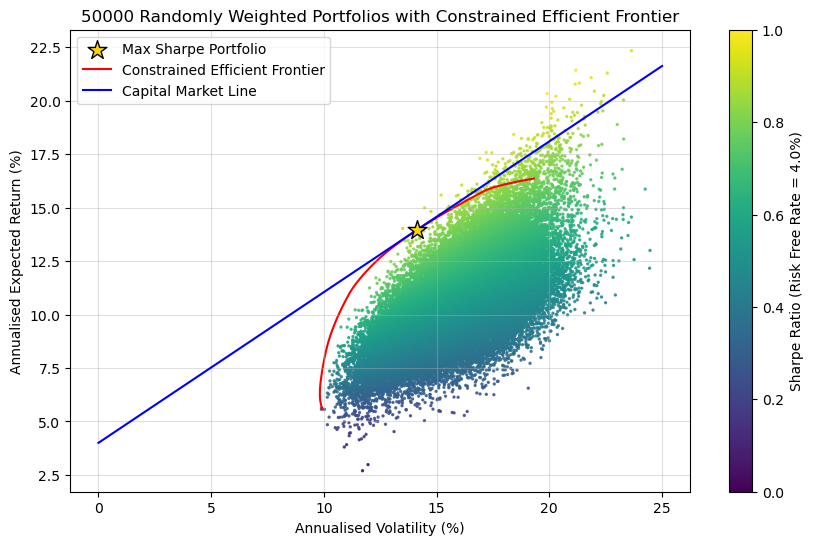
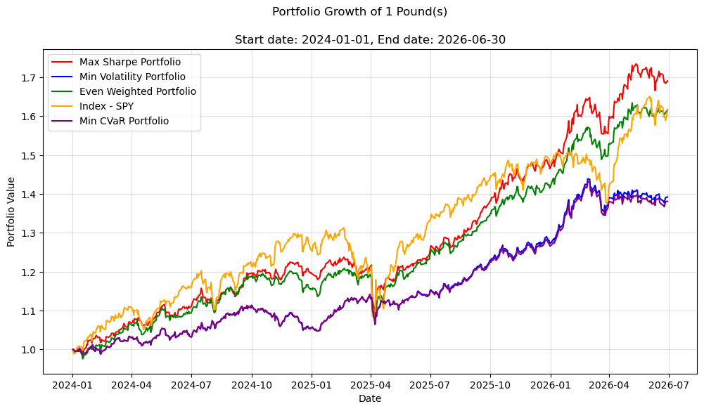

# Portfolio Optimisation: Markowitz, Monte Carlo and CVaR

A Python project that builds and tests mean-variance portfolios on a 15-asset, multi-asset-class universe. It compares randomly generated portfolios against exact optimisation with `scipy`, applies realistic position constraints, draws the efficient frontier and Capital Market Line, then tests the resulting portfolios on data they never saw. A CVaR (tail-risk) portfolio is added as an extension.

Everything is in one notebook: [`Portfolio_Optimisation_Main.ipynb`](Portfolio_Optimisation_Main.ipynb).

> **Disclaimer:** this is an educational project. It is not financial advice, and past or backtested performance does not predict future returns.

---

## What the project does

1. **Data:** downloads daily adjusted prices for 15 US-listed stocks and ETFs from Yahoo Finance (`yfinance`) and splits them into a training window (2019 to 2023) and an out-of-sample test window (2024 to June 2026).
2. **Monte Carlo simulation:** generates 50,000 random long-only portfolios (Dirichlet-distributed weights) and calculates each one's expected return, volatility and Sharpe ratio.
3. **Exact optimisation:** uses `scipy.optimize.minimize` (SLSQP) to find the maximum-Sharpe and minimum-volatility portfolios, and to trace the efficient frontier by minimising variance at a grid of target returns.
4. **Constraints:** repeats the optimisation with no shorting and a 15% cap on any single asset, and compares the two frontiers.
5. **Capital Market Line:** draws the line from the risk-free rate through the constrained maximum-Sharpe (tangency) portfolio.
6. **Out-of-sample backtest:** holds the optimised weights over the test window and compares them with an equal-weight portfolio and the S&P 500 (SPY), using realised return, volatility, Sharpe ratio and maximum drawdown. Predicted and realised statistics are compared side by side.
7. **CVaR extension:** finds the portfolio that minimises 95% Conditional Value at Risk (the average loss on the worst 5% of days) and backtests it against the others.

## Asset universe

| Group | Tickers |
|---|---|
| US equities | AAPL, AMZN, JPM, XOM, JNJ, PG, CAT, NEE |
| International equities | EFA (developed ex-US), EEM (emerging markets) |
| Real assets | VNQ (US REITs), GLD (gold), DBC (broad commodities) |
| Fixed income | TLT (20+ year Treasuries), LQD (investment-grade corporates) |

## Key settings

| Setting | Value |
|---|---|
| Training window | 2019-01-01 to 2023-12-31 |
| Test window | 2024-01-01 to 2026-06-30 |
| Risk-free rate | 4% (constant assumption) |
| Monte Carlo portfolios | 50,000 (random seed 5) |
| Trading days per year | 252 |
| Constrained scenario | Long-only, maximum 15% per asset |
| CVaR confidence level | 95% (daily) |

## Optimisation scenarios

| Scenario (as named in the notebook) | Weight bounds | Notes |
|---|---|---|
| Monte Carlo | 0 to 1, sums to 1 | Random sampling only |
| "Unconstrained" | 0 to 1, sums to 1 | Long-only with **no per-asset cap**. Shorting is not allowed in this scenario |
| Constrained | 0 to 0.15, sums to 1 | Long-only with a 15% cap |

## Results

All figures below are from the notebook as run with the settings above. Rerunning may give slightly different numbers if Yahoo Finance revises its data.

### In-sample (training window, 2019 to 2023): expected statistics

| Portfolio | Return (%) | Volatility (%) | Sharpe |
|---|---:|---:|---:|
| Monte Carlo max Sharpe | 21.43 | 21.17 | 0.82 |
| Monte Carlo min volatility | 5.57 | 9.89 | 0.16 |
| Constrained max Sharpe | 13.96 | 14.13 | 0.71 |
| Constrained min volatility | 6.26 | 9.82 | 0.23 |
| Uncapped long-only max Sharpe | 22.37 | 19.62 | 0.94 |
| Uncapped long-only min volatility | 5.06 | 9.01 | 0.12 |





Adding the 15% cap and the no-shorting rule moves the frontier inwards, because the optimiser can no longer concentrate in the highest-returning assets. The constrained maximum-Sharpe portfolio is forced to diversify, so it takes far less risk than the uncapped one.



### Out-of-sample backtest (2024-01-01 to 2026-06-30)

Constrained portfolios, held with fixed weights and rebalanced daily to constant weights.

| Metric | Max Sharpe | Min volatility | Equal weight | S&P 500 (SPY) | Min CVaR |
|---|---:|---:|---:|---:|---:|
| Annualised return (%) | 23.68 | 14.33 | 21.44 | 21.40 | 13.95 |
| Annualised volatility (%) | 11.08 | 8.29 | 10.59 | 15.97 | 8.32 |
| Cumulative return (%) | 69.10 | 39.23 | 61.65 | 61.51 | 38.12 |
| Sharpe ratio | 1.78 | 1.25 | 1.65 | 1.09 | 1.20 |
| Maximum drawdown (%) | -12.51 | -6.71 | -11.62 | -18.76 | -6.62 |
| Daily 95% CVaR (%) | -1.50 | -1.21 | -1.49 | -2.26 | -1.21 |



### Predicted vs realised

| Portfolio | Metric | Predicted (training) | Realised (test) |
|---|---|---:|---:|
| Constrained max Sharpe | Return (%) | 13.96 | 23.68 |
| | Volatility (%) | 14.13 | 11.08 |
| | Sharpe | 0.71 | 1.78 |
| Constrained min volatility | Return (%) | 6.26 | 14.33 |
| | Volatility (%) | 9.82 | 8.29 |
| | Sharpe | 0.23 | 1.25 |

## Main findings

- **Random sampling falls short of the true optimum.** With 15 assets, random portfolios rarely reach the efficient boundary, and the optimiser finds portfolios with better risk-adjusted returns than any of the 50,000 random draws.
- **Constraints have a visible cost in-sample.** The capped frontier sits inside the uncapped one, and the capped maximum-Sharpe portfolio has a lower Sharpe ratio, but it is far more diversified.
- **The optimised portfolios held up out of sample.** The maximum-Sharpe portfolio had the highest realised Sharpe ratio (1.78), ahead of equal weight (1.65) and SPY (1.09), and the minimum-volatility portfolios had the lowest volatility and drawdowns. The margin over equal weight is modest, which suggests that simple diversification captured most of the benefit.
- **Realised results beat the predictions.** The training window included the 2020 COVID shock and the test window was a strong market, so the comparison reflects a favourable regime and should not be read as evidence that the model forecasts well.
- **Minimising CVaR produced almost the same portfolio as minimising volatility** for this universe and constraint set, so the extra complexity added little here.

## Repository structure

```
.
├── Portfolio_Optimisation_Main.ipynb   # full analysis
├── README.md
├── requirements.txt
├── LICENSE
├── .gitignore
└── figures/                            # exported charts used in this README
```

## Method notes

- **Returns:** expected returns and the covariance matrix are estimated from daily **log** returns over the training window and annualised (mean × 252, covariance × 252). Backtest portfolio returns use daily **simple** returns, since a portfolio's return is the weighted average of its assets' simple returns.
- **Portfolio statistics:** return is `w'mu`, volatility is `sqrt(w' Sigma w)` and the Sharpe ratio is `(return - risk-free rate) / volatility`.
- **Efficient frontier:** variance is minimised for each target return, subject to the weights summing to one and the scenario's bounds.
- **Backtest:** weights are fixed from the training window and applied to test-window returns, with daily rebalancing to constant weights. Realised annualised return is geometric, volatility uses the sample standard deviation (`ddof=1`) times the square root of 252, and maximum drawdown is the largest fall from a running peak.
- **CVaR:** the historical average of daily returns at or below the 5th percentile, minimised with SLSQP.

## Assumptions and limitations

- Mean-variance optimisation is highly sensitive to the expected-return inputs, so the optimal weights partly reflect estimation noise and the particular training window.
- Returns are assumed stationary, with a stable covariance matrix and independent daily returns (the square-root-of-time scaling).
- There are no transaction costs, taxes or slippage, and the daily rebalancing assumption would be costly in practice.
- The backtest covers a single window of about 2.5 years in a rising market, so results are illustrative rather than statistically strong.
- The 4% risk-free rate is a constant assumption, not a time series.
- The stock selection involves hindsight (survivorship) bias, since the companies chosen are large and well-known.
- Predicted figures use mean log returns while realised figures use compounded simple returns, so part of any gap between them comes from the convention.
- The CVaR objective is non-smooth, which SLSQP handles imperfectly. A linear-programming formulation would be more robust.
- Data comes from Yahoo Finance via `yfinance`, which may contain errors or be revised.

## Possible extensions

- Covariance shrinkage (Ledoit-Wolf) and a sensitivity analysis over lookback windows, risk-free rates and cap levels.
- A rolling re-estimation backtest with transaction costs and turnover.
- A mean-CVaR efficient frontier using a linear-programming formulation.
- Alternative methods such as Black-Litterman or risk parity.

## Tech stack

Python, NumPy, pandas, SciPy, Matplotlib, yfinance, Jupyter.

## Licence

Released under the MIT Licence (see [`LICENSE`](LICENSE)).
